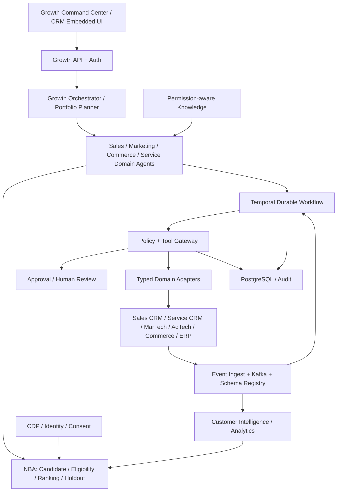
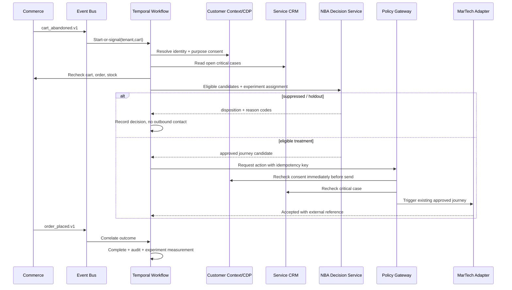

# Architecture — Enterprise Customer Growth AI Agent System

**Status:** Proposed reference design v1.0 | **Updated:** 2026-11-11 | **Architecture depth:** L2 capabilities and L3 implementation details

## 1. Architectural scope and decisions
Provide a governed growth intelligence and workflow layer above existing Sales CRM, Service CRM, MarTech, AdTech, E-Commerce, CDP/CMP, CMS, ERP/OMS, PIM, loyalty and analytics. Do not rebuild these applications. Local development uses synthetic customers and mock vendor adapters; production uses region- and tenant-approved connectors.

**Architecture decision records (proposed):**
- **ADR-001:** Federated domain agents (Sales, Marketing, Commerce, Service), shared decision intelligence and central orchestration. The central agent assigns tasks; domain services own domain tools.
- **ADR-002:** Durable, explicit workflows for side effects. Agents may propose actions; deterministic validators and policy gateway authorize them.
- **ADR-003:** Systems of record remain authoritative; PostgreSQL stores orchestration, recommendations and audit metadata, never primary orders or CRM records.
- **ADR-004:** Event-driven, at-least-once ingest with idempotent consumers, producer outbox/CDC where possible and compensating workflows.
- **ADR-005:** Candidate generation + hard policy gates + ranker + optional LLM explanation; model output never overrides consent, service, pricing, budget or authorization rules.
- **ADR-006:** Sandbox/mock connectors precede real vendors; initial vertical slice is service-aware cart recovery.

## 2. Recommended reference technology stack
These selections are implementation recommendations rather than approved enterprise standards.

| Concern | Reference selection | Rationale / alternative |
|---|---|---|
| Frontend / operator console | Next.js, TypeScript, React | Mature typed UI; can embed into CRM later |
| HTTP APIs | Python 3.12+, FastAPI, Pydantic v2 | Native AI/ML ecosystem, OpenAPI; TypeScript/NestJS viable |
| Agent workflows | Temporal Python SDK + explicit application state machines | Durable timers, retry, approval waits; LangGraph optional for bounded reasoning subgraphs |
| Agent/runtime LLM | Provider-neutral model gateway with structured JSON output | Swap OpenAI, Anthropic or Gemini per enterprise approval; no provider lock-in |
| Business rules / NBA | Python pure functions and policy decision service; optionally XGBoost for calibrated ranking | Eligibility explainability, testing, deterministic controls |
| Events | Kafka or managed equivalent + schema registry | Replay and ordered per-key processing; local Redpanda alternative |
| Operational DB | PostgreSQL 16+ | Strong transactions and tenant-scoped workflow metadata |
| Cache | Redis with tenant-namespaced keys | Short-lived nonauthoritative features; fail closed on unknown consent |
| Analytics | Existing Snowflake/BigQuery/Databricks | Preserve enterprise analytics stack; versioned metrics |
| Identity + consent | Existing CDP/MDM + authoritative consent management platform | No new shadow identity master |
| RAG | Approved indexed knowledge with scoped retrieval, optional pgvector | Least privilege and policy attribution |
| Integrations | Domain adapter interfaces over REST/GraphQL, iPaaS as applicable | Salesforce, Dynamics, Adobe, Braze, Shopify, SAP etc. |
| Infrastructure | AWS EKS, managed PostgreSQL, MSK, Secrets Manager, S3 as reference | Azure AKS/Event Hubs or GCP GKE/PubSub variants |
| Observability | OpenTelemetry, Prometheus/Grafana, traces, SIEM export | Cross-service audit and health visibility |
| CI/CD | GitHub Actions, Docker, IaC (Terraform), policy and contract gates | Enterprise runner / internal pipelines acceptable |
| Tests | pytest, testcontainers, schemathesis or openapi validation, Playwright | Unit, integration, contract, e2e and browser testing |

**MVP simplification:** Local Docker Compose with one API, one worker, Temporal dev environment, PostgreSQL, Kafka-compatible broker and mock adapters. Redis and model calls are optional; deterministic scoring must function without a paid AI API.

## 3. L2 logical component architecture

Detailed subsystem ownership and interfaces: [architecture/L2-components.md](architecture/L2-components.md). Detailed sequence diagrams: [architecture/L3-sequences.md](architecture/L3-sequences.md).

### Service boundaries
| Service | Owns | Does not own |
|---|---|---|
| growth-api | auth, input validation, command/query endpoints, operator views | downstream business truth |
| orchestrator-worker | task routing, durable state transitions, event correlation | unsupervised external actions |
| decision-service | candidate discovery, eligibility, ranker, holdout assignment, reason codes | permissions or consent master |
| policy-gateway | per-tool action authorization, consent revalidation, approvals, budgets | CRM/MarTech data storage |
| adapter-services | scoped vendor API calls, normalization, reconciliation | autonomous business policy |
| event-ingest | validation, dedupe, backpressure, DLQ, canonical event publishing | entitlement changes |
| customer-context | read-only purpose-scoped aggregate view from CDP, service and commerce | global identity master |
| audit-and-measurement | redacted trace, action outcomes, exposure/experiment data | causal lift without control group |

## 4. L3 runtime API boundaries
**Public-to-operator API:** OAuth2/OIDC with role and tenant-scoped authorization. Client supplies `X-Correlation-ID`; system generates one if absent. External controllers never call SaaS vendors directly.

**Core endpoints:**
- `GET /v1/customers/{customerId}/context` — minimized customer context subject to purpose and tenant scope.
- `POST /v1/decisions` — scored, policy-filtered NBA recommendation with versions and reason codes.
- `POST /v1/opportunities` — persists an agent recommendation, not an actual CRM opportunity.
- `POST /v1/actions` — submit action intent to durable execution, with `Idempotency-Key`.
- `GET /v1/actions/{actionId}` — observed outcome.
- `POST /v1/approvals/{approvalId}/decisions` — human authorization; execution gateway revalidates eligibility.

Canonical source-of-truth OpenAPI: [contracts/openapi.yaml](contracts/openapi.yaml). Authorization is **not** inferred from LLM-generated text. Human approvers authenticate as real users; a machine token alone cannot impersonate an approver.

### Event contract
**Existing canonical topics:** `commerce.cart_abandoned.v1`, `commerce.order_placed.v1`, `service.case_escalated.v1`, `growth.action_executed.v1` (see [contracts/asyncapi.yaml](contracts/asyncapi.yaml)). Proposed post-MVP extensions include `web.lead_submitted.v1`, `sales.task_created.v1`, `marketing.journey_enrolled.v1`, `service.case_resolved.v1`, `growth.exposure_recorded.v1`, `growth.conversion_observed.v1`.

Envelope must include `eventId`, `eventType`, `schemaVersion`, `tenantId`, `aggregateId`, `occurredAt`, `correlationId`, `source`, `data`, and optionally `region`. Producers use outbox or equivalent transactional delivery. Consumers dedupe `(tenantId,eventId)`, preserve order by tenant/aggregate partition key, tolerate out-of-order events and never assume exactly-once broker delivery. PII is tokenized or excluded.

## 5. L3 AI agent orchestration and tool contracts
**Agent hierarchy:** Growth orchestrator → domain-specific agents → capability tools. The Growth Orchestrator cannot bypass policy gateway. Agents use structured task payloads (task ID, tenant, purpose, customer reference, context snapshot hash, deadline, allowed tools, expected outcome). Each domain agent returns a structured proposal and optional explanation with model/version ID; the workflow engine—not the model—owns side-effect state.

**Decision pipeline:**
1. **Build candidates** from event type and approved rules; no arbitrary action names.
2. **Hard eligibility:** customer identity, purpose/consent, jurisdiction, case severity, duplicate order, stock, frequency cap, offer constraints, channel policy.
3. **Score** eligible candidates by expected incremental contribution, confidence, cost, fatigue and business priority. Use explicit ranker with logged weights or calibrated ML version.
4. **Experiment allocation:** deterministic, persisted assignment by experiment/customer/tenant, including control cohort.
5. **Plan:** domain agent fills typed tool parameters; structured model outputs must validate against schema.
6. **Authorize:** gateway checks role, tenant, purpose, allowed tool, input constraints and approval state.
7. **Execute:** Temporal activity calls vendor adapter with stable idempotency key; reconcile ambiguous results before retry.
8. **Observe:** wait for authoritative vendor event/result; persist outcome and metrics.

**Workflow state:** `RECEIVED → CONTEXT_PENDING → CANDIDATES_GENERATED → POLICY_CHECKED → (APPROVAL_PENDING) → EXECUTING → AWAITING_OUTCOME → COMPLETED`; terminal alternatives `SUPPRESSED`, `REJECTED`, `EXPIRED`, `CANCELLED`, `FAILED_REVIEW`.

**Agent permissions:** default read-only; mutation via registry only. Production tools grouped by service domain. Initial allowlist: `get_customer_profile`, `get_cart_context`, `get_order_status`, `get_service_health`, `get_consent`, `get_inventory`, `trigger_approved_journey`, `get_action_status`. Promotional send, discount, price, payment, and advertising-spend tools are never exposed in MVP. See [workflows/agent-policies.yaml](workflows/agent-policies.yaml).

## 6. L3 MVP sequence — service-aware abandoned cart

**Critical races:** If order placement, consent withdrawal or severe case occurs before send, suppress; if the vendor times out, query external action by idempotency key before retry. Non-retriable policy failures do not retry. Retryable failures use bounded backoff, DLQ, operator review. Kill switch suppresses all outbound actions immediately.

## 7. Data architecture
- **Logical customer model:** CDP/MDM global identity, purpose-scoped contact preferences, account/person relationships; CRM opportunity/case refs; commerce cart/order refs; product/price/stock refs; activity signals and model features.
- **Operational store:** `growth_opportunity`, `growth_decision`, `growth_action`, `human_approval`, `processed_event`, `audit_record` (see [schemas/postgres.sql](schemas/postgres.sql)). Do not store raw customer profiles, payment data or messaging content in agent tables.
- **Analytical events:** treatment assignment, exposure, outcome, intervention cost; join only with approved pseudonymous keys. Govern retention and data residency.
- **Cache:** nonauthoritative and short TTL; never use stale cache as proof of active consent or absence of severe service cases.
- **Knowledge / RAG:** brand messaging, product/service facts, policies, support documentation; access controlled and source versioned; untrusted retrieved content is data, never instructions.
- **Lineage:** correlation ID, source system ID, normalized event ID, context snapshot hash, policy version, model version, action external reference.

More detailed schema and ER model: [DATA_MODEL.md](DATA_MODEL.md).

## 8. Security and governance
- OIDC for humans; workload identity/mTLS/service OAuth for workers; secrets vault rather than static `.env` in production.
- Every request must bind `tenantId` to authenticated identity, not trust request body; region and purpose scopes enforced.
- Policy enforcement: tenant, residency, lawful purpose, consent, critical service status, frequency, channel, budget, allowlisted tool, approvals; **rechecked immediately before execution**.
- LLM protections: parameterized tools, typed responses, retrieval allowlists, prompt injection screening, strict tool-call authorization, output and source filtering; no secrets, PII, or privileged instructions in prompts.
- Audit: append-only records with redaction and immutable export; record decision rationale and model/policy versions; maintain data deletion/retention processes.
- Approvals: explicit state transitions; expiration, authorization scopes and separation of duties. High-impact budget/pricing/novel-publication operations out of MVP.
- Threat-model cross-tenant injection, event forgery, poisoned RAG content, fake vendor callbacks, replay, race conditions and SSRF.

## 9. Deployment, scalability and observability
**Cloud layout:** edge WAF + OIDC → private API and worker services in regional Kubernetes → managed Temporal / broker / PostgreSQL → controlled egress to SaaS vendor APIs. Use separate regional state and queues when required. Multi-AZ, network policy, IAM, KMS, encryption and rate limiting required in production.

**Scale controls:** horizontal worker pools by workflow domain; backpressure by tenant; Kafka partitions by tenant/customer or cart; per-vendor quotas; autoscaling based on queue lag and CPU; data retention/partitioning in PostgreSQL; circuit breakers with controlled degradation.

**Telemetry:** request traces, workflow transition events, policy denials, action attempts, vendor response, queue lag, DLQ count, decision p50/p95/p99, duplicate suppression, cost per outcome, holdout conversion, send violations. Configure alerts on leakage, error budget, consent-policy mismatches and stuck approvals.

**Provisional NFRs:** internal decision API 99.9%; cached NBA p95 ≤1.5s; event-to-decision p95 ≤60s; no duplicate external writes and no policy-violating sends; recovery targets RPO/RTO 15/60min. Validate under expected customer volume. See [delivery/NFR-and-tests.md](delivery/NFR-and-tests.md).

## 10. Enterprise integration boundaries and onboarding
1. Define authoritative owner per entity/attribute and adapter endpoint, including vendor sandbox permissions.
2. Define inbound event mapping to versioned canonical schema and PII minimization.
3. Establish tenant, region, account hierarchy and purpose mapping.
4. Implement read and action tools with least privilege, rate limit, retry semantics and idempotency.
5. Verify vendor receipt/event reconciliation in sandbox, then resilience and policy tests before canary.
6. Real production connector requires platform owner, legal/privacy, security, data governance and SRE review.

**Vendor-specific connector work is not yet implemented.** Generic OpenAPI/AsyncAPI contracts are reference interfaces; differences in provider endpoint capabilities must be addressed in adapter-specific specifications.

## 11. Verification architecture
- Lint documentation, OpenAPI, AsyncAPI, SQL and YAML; prevent broken relative links.
- Unit test candidate generation, ranking, eligibility, assignment and policy rule precedence.
- Contract-test adapters against vendor sandbox/mocks; validate schema compatibility.
- Integration-test Temporal state, broker replay, duplicate and out-of-order messages, source-of-truth rechecks.
- E2E test approved journey and suppression with synthetic customers; inject timeouts, consent revocation, case escalation, and completed order races.
- Stress test throughput, retry storms and per-tenant quotas; verify region isolation.
- Gate deployment by security, privacy, experiment measurement and rollback demonstration.

## 12. References
[PRD.md](PRD.md) · [DATA_MODEL.md](DATA_MODEL.md) · [IMPLEMENTATION_PLAN.md](IMPLEMENTATION_PLAN.md) · [architecture/L2-components.md](architecture/L2-components.md) · [architecture/L3-sequences.md](architecture/L3-sequences.md) · [contracts/openapi.yaml](contracts/openapi.yaml) · [contracts/asyncapi.yaml](contracts/asyncapi.yaml) · [workflows/agent-policies.yaml](workflows/agent-policies.yaml)
