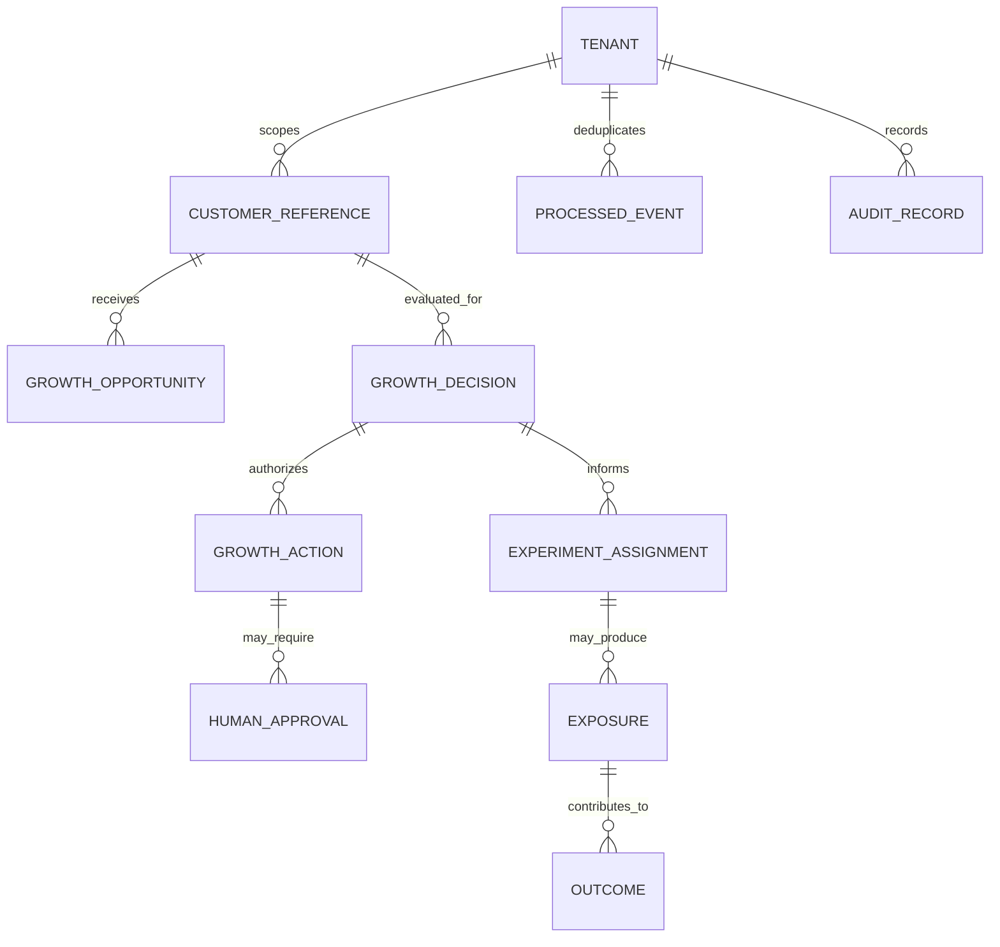

# Data Model — Enterprise Customer Growth AI Agent System

**Status:** Proposed logical and physical model v1.0 | **Updated:** 2026-11-11

## 1. Design constraints
- Existing CDP/MDM, CRM, Service CRM, E-Commerce, OMS, MarTech and CMP remain authoritative. The agent platform stores **references, derived decisions, workflow state and audit metadata** only.
- Tenant and region are required on all sensitive read/write paths; authenticated claims constrain tenant, purpose and region.
- Use tokenized/pseudonymous customer references in operational state, prompts, events and logs; prohibit card data and unnecessary raw PII.
- Keep analytical exposures/outcomes separate from operational transaction truth.
- The SQL in [schemas/postgres.sql](schemas/postgres.sql) is an initial scaffold; additional entities below are **design extensions** and require migrations before implementation.

## 2. Canonical identity and domain entities
| Entity | Key | Authoritative source | Important relationships / attributes |
|---|---|---|---|
| Tenant | tenant_id | Enterprise tenant registry | business unit, brand, region, policy set |
| Customer Identity | tenant_id + customer_ref | CDP / MDM | person/account identity, pseudonymous cross-system keys |
| Consent State | tenant_id + customer_ref + purpose + channel | CMP / CDP | grant status, source, effective timestamp, policy evidence |
| Account | system + external_account_id | Sales CRM / CDP | parent company, region, account owner |
| Lead / Contact | system + external_ref | Sales CRM | account and customer identity linkage |
| Opportunity (CRM) | system + external_opportunity_id | Sales CRM | account, stage, value, seller owner |
| Service Case | system + case_id | Service CRM | customer, severity, status, effective timestamp |
| Cart | system + cart_id | E-Commerce | customer, items, currency, cart status |
| Order | system + order_id | E-Commerce / OMS | cart, customer, order status, money totals |
| Product / Price / Stock | system + product_id | PIM / ERP / Commerce | availability, eligibility, price effective time |
| Campaign / Journey | vendor + journey_id | MarTech | approved version, channel and audience rules |
| Audience / Ad Activation | vendor + audience_id | CDP / AdTech | purpose, approval state, audience provenance |
| Growth Opportunity | opportunity_id UUID | Growth platform | trigger event, type, customer_ref, predicted incremental value |
| Decision | decision_id UUID | Growth platform | eligibility outcome, selected action, policy/model versions |
| Action | action_id UUID | Growth platform | decision, tool, idempotency key, state, vendor reference |
| Approval | approval_id UUID | Growth platform | action, approver, approved/rejected, expiration |
| Event Receipt | tenant_id + event_id | Growth platform | deduplication, ingest timestamp |
| Audit Record | audit_id UUID | Growth platform + immutable export | actor, operation, correlation, outcome, metadata |
| Experiment Assignment | tenant + experiment + customer | Experimentation service | deterministic treatment/holdout, assignment timestamp |
| Exposure | tenant + exposure_id | Experiment/measurement service | action, treatment, delivery timestamp |
| Outcome | tenant + outcome_id | Measurement pipeline | order conversion, revenue, observation window |

## 3. Logical relationship diagram


**Modeling clarification:** `CUSTOMER_REFERENCE` is a logical pointer resolved through the CDP/MDM, not a new raw-customer database. Diagram relationships to experiments are logical join relationships (not yet physical foreign keys).

## 4. Operational PostgreSQL schema (implemented scaffold)
Reference DDL: [schemas/postgres.sql](schemas/postgres.sql). Tables and constraints:

| Table | Primary key | Important columns | Unique / index |
|---|---|---|---|
| `growth_opportunity` | `opportunity_id` | tenant_id, customer_ref, opportunity_type, source_event_id, value/currency, status | `(tenant_id,source_event_id,opportunity_type)` unique; customer lookup |
| `growth_decision` | `decision_id` | tenant_id, customer_ref, trigger_event_id, purpose, disposition, reason_codes JSONB, versions, snapshot hash | `(tenant_id,trigger_event_id,purpose)` unique |
| `growth_action` | `action_id` | tenant_id, decision_id, tool_name, state, idempotency_key, external_ref, attempts | `(tenant_id,idempotency_key)` unique; state index |
| `human_approval` | `approval_id` | tenant_id, action_id, requested_by, approver_ref, decision, expiry | indexed join to action recommended |
| `processed_event` | `(tenant_id,event_id)` | event_type, consumed_at | composite PK for deduplication |
| `audit_record` | `audit_id` | tenant_id, correlation_id, actor, operation, outcome, metadata | tenant/correlation index |

### Required hardening before production
- PostgreSQL row-level security tied to verified tenant session context; apply same tenant checks on cross-table references and avoid cross-tenant FK resolution.
- Typed enums/check constraints on decision dispositions and action states, foreign keys with tenant-aware compound keys where needed.
- Outbox table and transactional boundaries for workflow action state to event publishing.
- `updated_at` DB triggers, partitions/TTL and migration policy; audit immutable export to compliant object store.
- Idempotent upsert / concurrency control and workload-tested indices.
- No blind JSON storage of full customer records, emails, phone numbers, payment data or vendor access tokens.

## 5. Canonical event envelope and domain payloads
```json
{
  "eventId": "2aab97b9-ae8a-4825-89eb-8cfde69bba3f",
  "eventType": "commerce.cart_abandoned.v1",
  "schemaVersion": "1.0.0",
  "tenantId": "tenant-demo",
  "aggregateId": "cart-demo-001",
  "occurredAt": "2026-11-11T15:30:00Z",
  "correlationId": "46f4453b-7273-4b25-8ec8-bdc10c02fab4",
  "source": "commerce-adapter-mock",
  "region": "us-east-1",
  "data": {
    "cartId": "cart-demo-001",
    "customerRef": "cust-demo-001",
    "currency": "USD",
    "cartValue": 120.0,
    "itemIds": ["sku-demo-01"]
  }
}
```

**Current contract events:** `commerce.cart_abandoned.v1`, `commerce.order_placed.v1`, `service.case_escalated.v1`, `growth.action_executed.v1` in [contracts/asyncapi.yaml](contracts/asyncapi.yaml).

**Envelope semantics:** `eventId` globally unique within source, dedupe on tenant/event; `aggregateId` partition key; `occurredAt` event time vs ingestion time; `correlationId` root trace; schema version follows compatibility policy. Nested `data` payload is versioned by eventType. Do not add a field containing customer PII without an explicit privacy review.

**Out-of-order events:** An order for cart X may reach the bus before the abandonment signal. Consumers must use an authoritative order status recheck, not only the latest received message.

## 6. Decision contract and business semantics
Decision request requires tenant, customer, purpose, trigger event and candidate set. Example:
```json
{
  "tenantId": "tenant-demo",
  "customerId": "cust-demo-001",
  "purpose": "cart_recovery",
  "triggerEventId": "2aab97b9-ae8a-4825-89eb-8cfde69bba3f",
  "candidates": [{"actionType": "approved_journey", "channel": "email", "score": 0.72, "expectedIncrementalValue": 8.0}]
}
```
The server must **derive** authoritative tenant identity from auth context and reject mismatch. `score` and `expectedIncrementalValue` supplied by clients are untrusted hints and must be recomputed or validated before policy/ranking. Return `decisionId`, `disposition`, reason codes, policy version and (when used) model version. The `disposition` can be `eligible`, `suppressed`, `holdout`, or `review_required`.

**Policy precedence:** Tenant/region auth > consent/legal purpose > critical service case > customer/order/stock eligibility > frequency/offer cap > experiment holdout > ranking/selection. Hard suppression is never overridden by ranker confidence.

## 7. Proposed extensions for experiments and reliability
New tables (not yet in `postgres.sql`):
- `experiment_definition(experiment_id, tenant_id, version, eligibility_rule_version, allocation_fraction, started_at, ended_at)`
- `experiment_assignment(tenant_id, experiment_id, customer_ref, arm, assigned_at, assignment_hash)` with unique `(tenant_id,experiment_id,customer_ref)`.
- `growth_exposure(exposure_id, tenant_id, experiment_id, customer_ref, action_id, vendor_ref, exposed_at)`.
- `growth_outcome(outcome_id, tenant_id, customer_ref, order_ref, amount, currency, occurred_at, attribution_window)`.
- `outbox_event(outbox_id, tenant_id, aggregate_id, event_type, payload, created_at, published_at)`.
- `workflow_instance(workflow_id, tenant_id, trigger_event_id, aggregate_id, status, started_at, completed_at)` only if workflow engine state alone is insufficient for operator queries.

**Experiment logic:** stable deterministic assignment; control receives no treatment. Delivery/exposure must be separately confirmed; absence of click is not nonexposure. Join outcomes using approved pseudonymous ID and pre-agreed attribution windows. Power and lift calculation specified by analytics owner.

## 8. Retention, governance and lineage
| Data class | Handling | Retention decision |
|---|---|---|
| Raw source customer PII | Keep in authoritative enterprise stores; access purpose-filtered | Owned by client privacy policy |
| Customer reference and decision metadata | Encrypt and scope by tenant | TBD by privacy/legal |
| Operational action and workflow state | Retain for replay, audit and disputes | TBD by SRE/legal |
| Audit log | Redact/append-only; immutable export | TBD by compliance/legal |
| Analytics events | Pseudonymize; aggregate for reporting | TBD by analytics governance |
| Ephemeral model context | Avoid storage, redact telemetry, enforce vendor retention conditions | Shortest technically feasible, policy-defined |

Maintain lineage across source event, context snapshot, decision, policy/model versions, action attempt, vendor acknowledgement and order/experiment outcome. Deletion requests need a data map including caches, audit exceptions, vendor recipients, embeddings and backfills.

## 9. Data quality acceptance tests
1. Duplicate event produces one canonical receipt and at most one external action.
2. Two tenants with same customerRef never see each other's profile/action/experiment state.
3. Consent revoked after initial NBA but before tool call suppresses action.
4. Critical service case mid-flight blocks messaging; case resolution does not imply automatic consent.
5. Order received before abandonment still suppresses recovery.
6. Order currency, timestamps, customer references and required identifiers validate against contracts.
7. Audit event contains no raw email/phone/card data and has correlation ID.
8. Replaying DLQ does not change stable experiment assignment.

## 10. References
[PRD.md](PRD.md) · [ARCHITECTURE.md](ARCHITECTURE.md) · [IMPLEMENTATION_PLAN.md](IMPLEMENTATION_PLAN.md) · [schemas/postgres.sql](schemas/postgres.sql) · [contracts/openapi.yaml](contracts/openapi.yaml) · [contracts/asyncapi.yaml](contracts/asyncapi.yaml)
