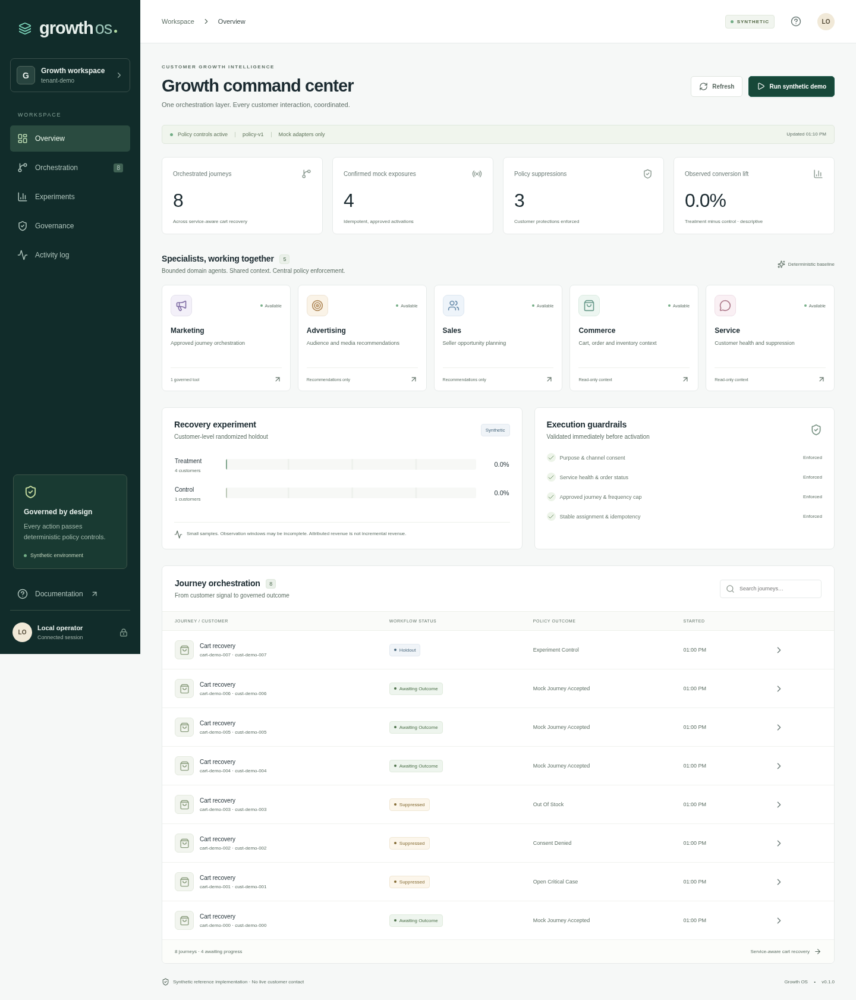

# Customer Growth Agents

A vendor-neutral, governed multi-agent system spanning **Marketing, Advertising, Sales, Commerce and Service**, with an AWS deployment foundation and pluggable Salesforce, Adobe Experience Platform and Shopify connectors.

Version 0.2 adds normalized regional workflows, five domain tools, a portfolio console, tenant identity bindings, optional model advice, sandbox connectors, immutable audit export and deployment automation. The original `/v1` service-aware cart recovery contracts remain supported. The implementation is runnable and tested with synthetic data; account-specific sandbox acceptance, production load, recovery and business approvals remain release gates.



## Run

Requires Python 3.12+, [uv](https://docs.astral.sh/uv/), Node.js 24, Docker Engine and Compose v2. Allow at least 12 GB free disk; Docker vfs can require more.

```bash
make setup     # frozen dependencies and private local configuration
make dev       # PostgreSQL, Kafka, Temporal, API, regional worker, sandbox and console
make token     # short-lived development admin token
```

Open **http://localhost:3000**, enter the token, open **Enterprise workflows**, and run the all-domain demo. Inspect the five agent reports, approve the Advertising audience action, and view connector capabilities. The seven scenarios cover all five tools, service suppression and opt-out. The original cart recovery demo remains available from Overview. API docs: http://localhost:8000/docs. Temporal UI: http://localhost:8233.

Local demos explicitly enable simulated execution for their tenant. They never contact Salesforce, Adobe or Shopify. Tokens stay in browser memory. `make down` preserves volumes. A smaller developer runner uses SQLite: `make setup`, `make local`, and `npm run dev --prefix apps/growth-console` in another terminal. Use Compose for durable execution.

For inspecting HTTPS proxies, use the trusted public CA build secret in [deployment/compose.proxy-build.yaml](deployment/compose.proxy-build.yaml).

## Domain workflows

| Signal | Governed tools |
|---|---|
| Cart abandoned | Approved Marketing journey and Commerce recommendation |
| Lead submitted | Qualified Sales follow-up task and approved nurture journey |
| Audience requested | Approved Advertising audience membership; human approval required by default |
| Product interest | Eligible Commerce recommendation and qualified Sales task |
| Service risk | Internal Service recovery task; severe cases suppress promotion |
| Case resolved | Service follow-up and approved retention journey |

Service and Commerce assess constraints before the other planners. Optional model advice receives bounded boolean/numeric facts and produces schema-validated recommendations; deterministic policy controls every tool. No model grants eligibility, modifies budgets, sets prices, invents discounts or sends free-form messages. Advertising budget drafts are descriptive and have no execution endpoint.

Before effects, the gateway rechecks current identity version, purpose, consent, severe service cases, orders, inventory, entitlements, price freshness, contact frequency, policy version, approval and tenant/global switches. Ambiguous acknowledgements reconcile authoritative receipts. Audit chains, idempotency keys, transactional outbox and stable Temporal workflow generations survive retries and replay.

## Enterprise integrations

| Provider | Implemented boundary |
|---|---|
| AWS | Terraform for private regional EKS, multi-AZ encrypted PostgreSQL, IAM-authenticated MSK Serverless, KMS, Secrets Manager and immutable S3 audit storage; Helm API/worker replicas, HPA, disruption budgets, security contexts and network policy |
| Salesforce | Sandbox Contact/Case/Task context; optional idempotent internal Task upsert using a verified unique external-ID field; no pipeline stage mutation |
| Adobe Experience Platform | Named non-production sandbox profile, explicit purpose and consent mappings; activation uses an approved idempotent HTTP bridge, not an invented native delivery guarantee |
| Shopify | Read-only customer/order/inventory/product GraphQL context and authenticated order webhook; no pricing, discount or order mutation |
| Model provider | Optional HTTPS OpenAI-compatible JSON advice with host/region binding, time/size/token limits and deterministic fallback |

Configure credentials server-side in an approved vault. Customer identity bindings have a separate tenant-scoped database lifecycle. See [connector setup](delivery/CONNECTORS.md), [AWS deployment](infrastructure/aws/README.md), and [operator runbook](delivery/RUNBOOK.md). No AWS resources or real customer actions are deployed by repository setup or CI.

## Verify

```bash
make lint test test-e2e security
# With infrastructure running:
docker compose up -d postgres temporal broker
make test-integration
# Complete synthetic stack:
uv run python scripts/smoke_stack.py
uv run python scripts/load_test.py --requests 100 --concurrency 8
# Deployment templates, requires Terraform 1.13.4 and Helm 3.19:
make infrastructure
# Browser, requires Chromium:
npm run build --prefix apps/growth-console
PLAYWRIGHT_CHROMIUM_EXECUTABLE=/usr/bin/chromium npm test --prefix apps/growth-console
```

[CI](.github/workflows/ci.yml) runs quality/security, browser, PostgreSQL/Kafka/Temporal, infrastructure validation and complete-container/load jobs, retaining execution artifacts. [Implementation status](delivery/IMPLEMENTATION_STATUS.md) distinguishes executed evidence from remaining release gates.

## Repository

| Path | Purpose |
|---|---|
| `src/growth/enterprise/` | Regional typed core, planners, deterministic gateway, normalized state, worker, sandbox, budgets and audit archive |
| `src/growth/connectors/` | Vendor adapters, credential templates and tenant identity resolution |
| `src/growth/engine.py`, `agents.py`, `policy.py` | Compatible v1 recovery workflow and experiment reporting |
| `src/growth/auth.py`, `observability.py`, `broker.py` | Verified claims, redacted tracing and TLS/IAM clients |
| `apps/growth-console/` | Responsive TypeScript operator console |
| `contracts/`, `packages/contracts/` | Versioned OpenAPI/AsyncAPI/JSON Schema and generated TypeScript |
| `schemas/`, `scripts/migrate.py` | Additive migrations, forced RLS, immutable audit and indexes |
| `deployment/helm/`, `infrastructure/aws/` | Regional deployment foundation |
| `tests/`, `delivery/` | Verification, operating procedures and acceptance evidence |

The supplied [PRD](PRD.md), [architecture](ARCHITECTURE.md), [data model](DATA_MODEL.md), [implementation plan](IMPLEMENTATION_PLAN.md) and [repository guidance](AGENTS.md) remain design context. [ADR-008](architecture/adr/008-regional-enterprise-core.md) describes this implementation and its production boundaries.
