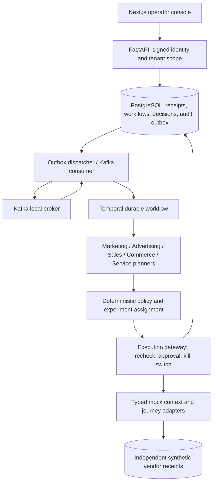

# Components and ownership

Implementation map: `growth.api` authenticates operators/producers; `growth.engine` owns transactional orchestration metadata; `growth.agents` returns typed proposals; `growth.policy` applies hard gates; `growth.adapters` defines protocol boundaries and mock implementations; `growth.event_worker` owns broker delivery; `growth.temporal_worker` owns durable timers and bounded retry orchestration. [ADR-007](adr/007-local-reference-runtime.md) explains the deployment and storage choices.
