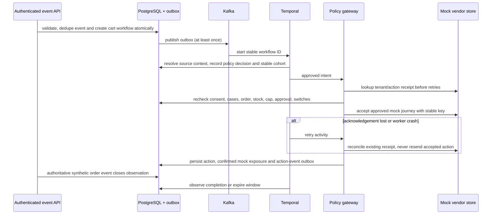

# Execution and recovery

Unconfirmed vendor status goes to FAILED_REVIEW and DLQ. Only operator replay can reopen it, and replay revalidates policy and reconciles first. Permanent errors cannot be replayed. Duplicate event IDs with changed contents are rejected; different abandonment event IDs for the same tenant/cart reuse the workflow. Late order events never reopen an action. Workflow cancellation prevents subsequent activation. Normal retries are bounded and Temporal schedules backoff; inline mode is a synchronous testing convenience.
